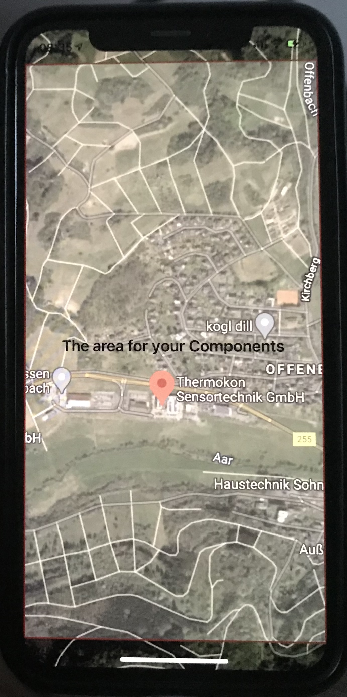
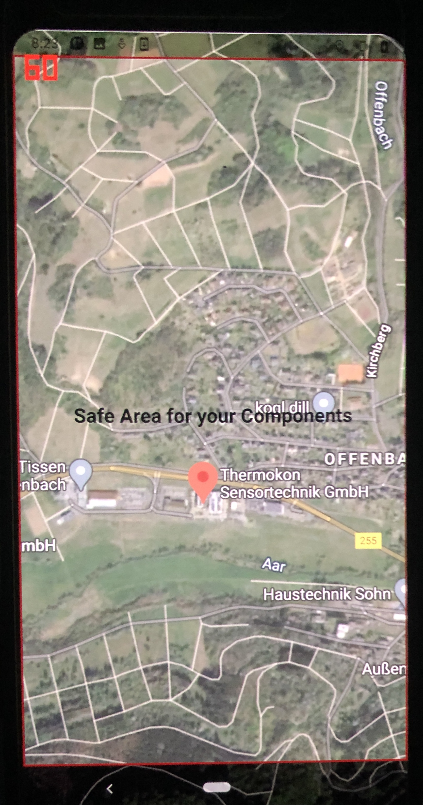
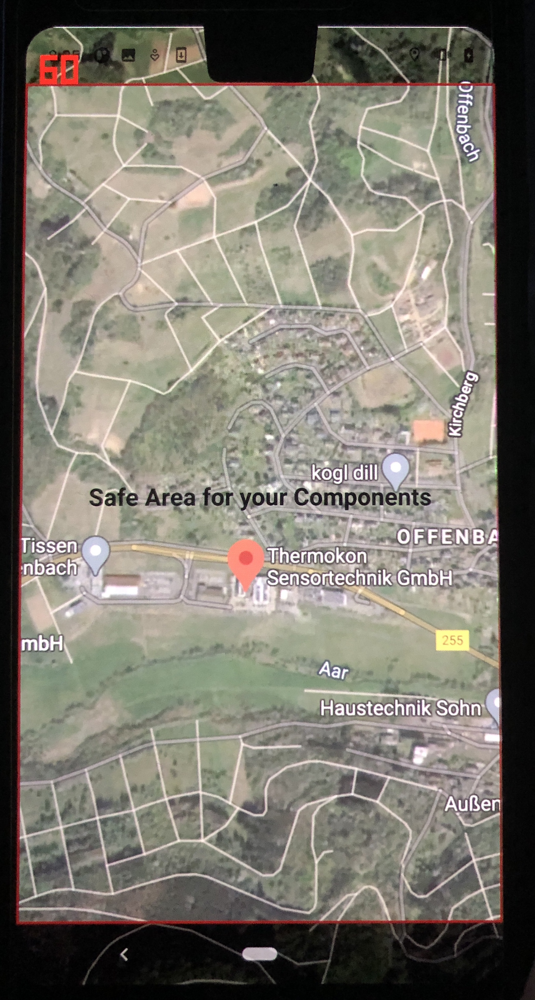
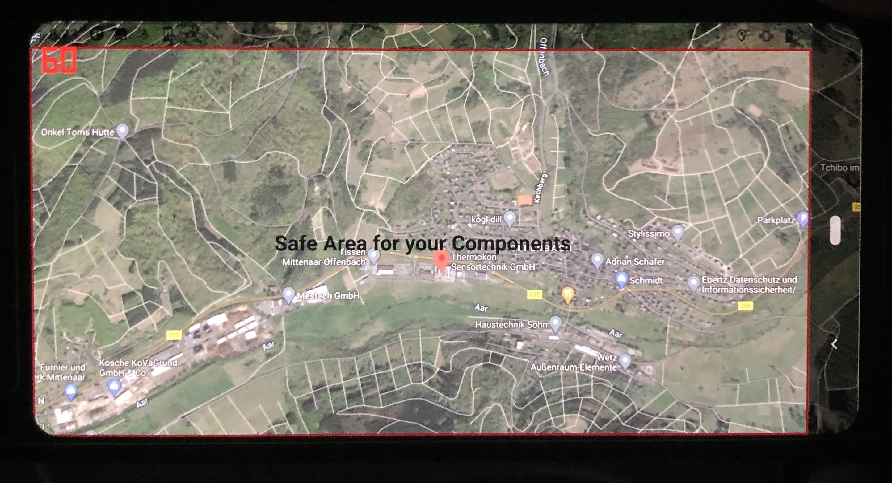

# PaintBehindSystemBars

Have you ever wondered how apps like Google Maps paint the map content behind the status and navigation bar?

## Example GoogleMaps


This repository shows how to let a basic QML application paint behind the system bars and how to know where the bars are, on iOS and Android.

## Qt 6 (6.9 and newer, target 6.12)

Since Qt 6.9 everything this example used to do by hand is built into Qt:

* `Qt::ExpandedClientAreaHint` lets the window content extend behind the status bar, navigation bar,
  display cutouts and (on desktop) the title bar. It replaces `Qt::MaximizeUsingFullscreenGeometryHint`
  on iOS and the custom `QtActivity` subclass with its window flags on Android.
* The `SafeArea` attached property (`import QtQuick`) reports the margins that content must respect.
  The margins update automatically, for example when the device is rotated, so the old timer
  workaround is no longer needed. It replaces the custom `SafeArea` C++ class, the private
  `QPlatformWindow` header and the JNI calls into Java.

### Main.qml
``` qml
Window {
    id: root
    flags: Qt.Window | Qt.ExpandedClientAreaHint | Qt.NoTitleBarBackgroundHint

    Image {                         // painted behind the system bars
        anchors.fill: parent
        source: "ressources/Maps.png"
        fillMode: Image.PreserveAspectCrop
    }

    Rectangle {                     // your components, inside the safe area
        anchors {
            fill: parent
            topMargin: root.contentItem.SafeArea.margins.top
            leftMargin: root.contentItem.SafeArea.margins.left
            rightMargin: root.contentItem.SafeArea.margins.right
            bottomMargin: root.contentItem.SafeArea.margins.bottom
        }
    }
}
```

No platform specific code, no `android/` package directory and no `gui-private` dependency are needed anymore.

### Build

``` bash
qt-cmake -S . -B <build-dir>
cmake --build <build-dir>
```

The Qt 5 version of this example (custom Java activity, JNI and `QPlatformWindow::safeAreaMargins()`)
is still available in the history of the `main` branch.

## Example images
### iOS


### Android



